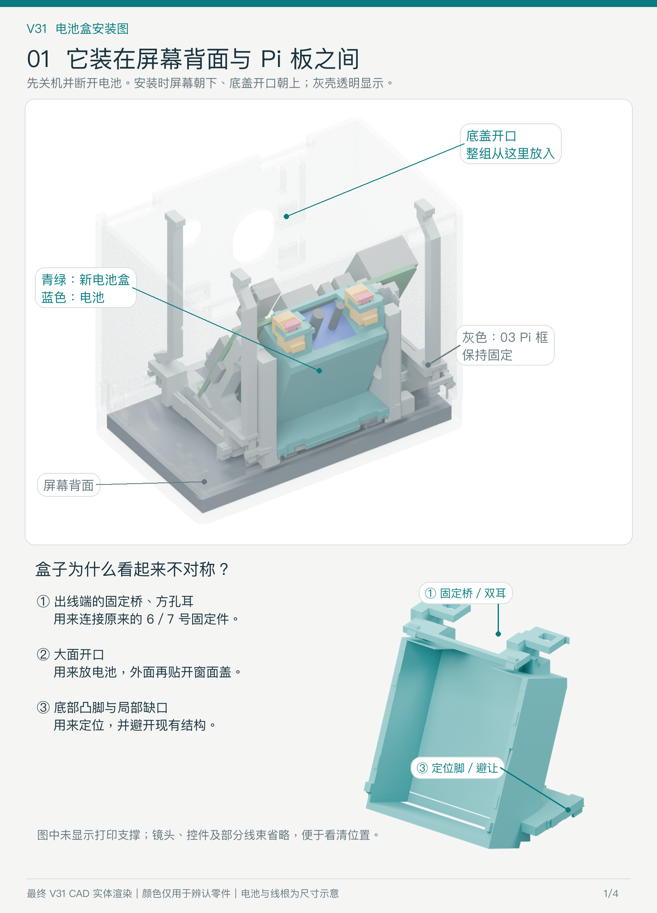
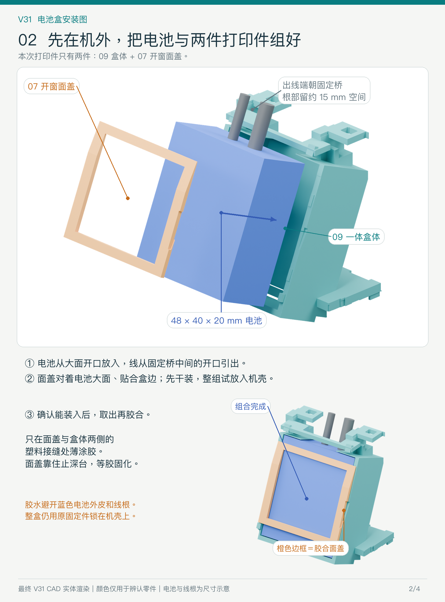
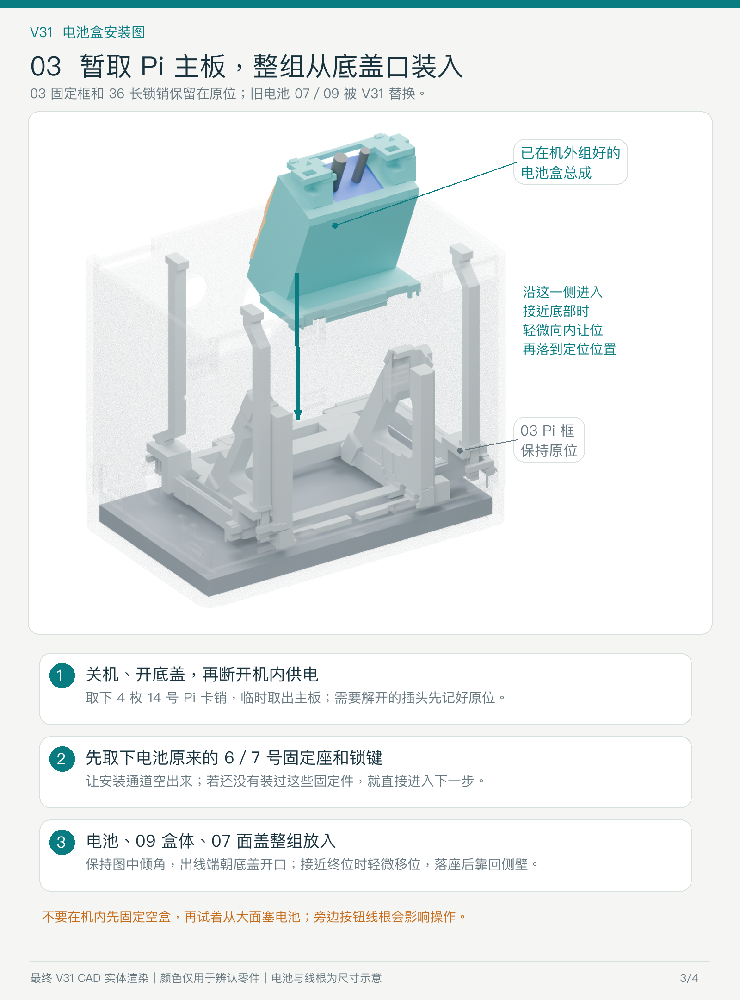
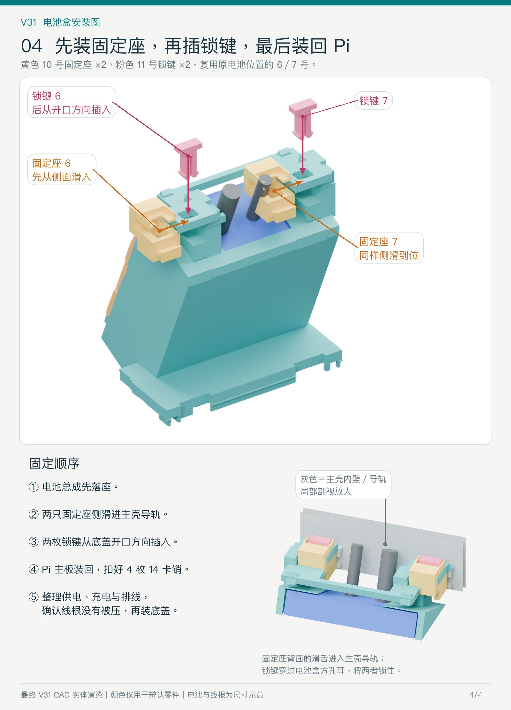

# V31 电池盒安装图

2026-10-28。以最终 `source/meshes-delivery.json` 和当前整机毫米装配为准，本次只制作说明图，未修改制造模型。

电池盒倾斜装在屏幕背面与 Pi 板之间的原电池位置，出线端朝底盖开口。两侧方孔耳与一体固定桥、底部定位脚、局部避让缺口均是正式结构。青绿为 09 盒体，橙色为 07 开窗胶合面盖，蓝色为电池；图中颜色仅用于辨认，软线仅画出线根示意。灰色 03 Pi 固定框保留在原位，Pi 主板可临时取出。

1. 正常关机、拔外部充电线，托住并打开底盖；露出机内供电接头后断开电池供电，再处理内部件。
2. 在机外把电池从 09 的大面开口放入，出线端朝一体固定桥，根部留约 15 mm 舒缓空间。07 面盖对着电池大面，贴合盒体两侧塑料边缘。
3. 先不涂胶。取下四枚 14 Pi 卡销、临时取出 Pi 主板；影响移动的插头需先记好原位。03 框与 36 长销保持原位。旧电池 07、09 由 V31 替换；旧 6/7 固定座与锁键先取下，让出通道。
4. 将电池、盒体与面盖临时组好，从底盖口整组试放。保持原倾角，接近终位时轻微向内让位，再落座、靠回侧壁。不要先在机内固定空盒后再塞电池。
5. 确认总成能顺利装入，再取出。只在 07 与 09 两侧塑料接缝处薄涂胶，面盖靠住止深台，等待胶充分固化。胶不接触电池外皮、线根或主壳。
6. 电池总成放回后，原 10 号电池固定座 6、7 从侧面滑入主壳内壁导轨；再把原 11 号锁键 6、7 从底盖开口方向插入方孔耳，锁住盒体与固定座。这四件复用旧件，未包含在本次两件电池盒 3MF 中。
7. 装回 Pi 主板及四枚 14 卡销，恢复原有线束连接；整理供电、充电与排线，确认底盖和元件没有压线根后，装回底盖。

图是实际 CAD 位置与装配方向示意，尚未验证用户这次打印实物的卡紧程度和胶接强度。图 4 的灰色壁是主壳局部剖视，便于看清导轨。

