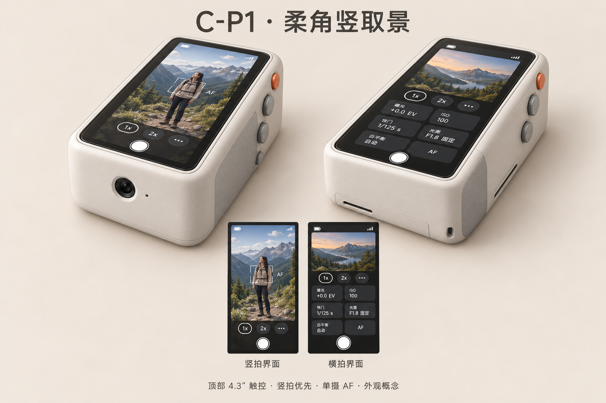

# Junshu 相机 PRD 草案

版本：v0.1.4 · 更新：2026-10-13（Asia/Shanghai）

状态：第1至45题已回答，新增触屏拍照确认；首台范围已明确，RAW实际拍摄延后；尚未形成最终验收基线。

## 1. 产品定位

做一台 Junshu 自己能带出门的完整相机，主要拍静止街景、旅行生活记录和户外朋友人像。需要时再开机，以手持为主，也可使用背带或放包。

优先白天户外，其次室内；当前不考虑夜晚拍摄。桌上食物、近距离人像、对街建筑都需要覆盖。夜晚取舍是用户决定，本稿未据此宣布传感器已被证明无法夜拍。

## 2. 已确定的主要体验

- 触屏为主；取景界面可点击拍照，也可使用实体拉杆；另有实体开关机键。
- 首台实际保存JPEG；保留JPEG、RAW、JPEG+RAW三个格式入口，涉及RAW的选择提示“raw暂不支持”。
- 四种照片比例；1×仍按比例裁切，2×另加数字裁切，取景与JPEG范围一致。
- 默认自然还原，重点检查色彩与清晰度；LUT风格留到后期。
- 首次自动曝光、EV 0；后续恢复上次倍率、曝光、白平衡与屏幕亮度，启动完成直接取景。
- 单次拍照；自拍延时3s/5s/10s；拍后回显关闭/3s/10s，默认3s。
- 完整触屏图库：单张、多张回看、二指缩放、多选批删；删除前确认。
- microSD导出至Mac和Windows；开卡槽盖取卡。成品内置电池，测试暂用充电宝。

## 3. 确认状态与首台范围

“已确认”表示产品要求已由用户提出，不表示硬件已经支持或功能已经实现。“待决定”需补充产品规则；“待实测”需真实设备证据；“建议”尚未获用户确认。

第32题已确认其余已确认功能均为首台必做，记为P0。第38题作出明确例外：首台不执行RAW或JPEG+RAW拍摄，只保留提示入口。尺寸、重量、续航及性能阈值仍按实测决定；本稿继续作为草案。

<!-- PDF-PAGE -->

## 4. 照片输出与所见即所得

| 项目 | 已确认规则 | 状态 |
| --- | --- | --- |
| 用途与观感 | 手机查看、电脑编辑；自然还原，色彩和清晰度优先。 | 已确认；样片待评 |
| 比例 | 3:4、1:1、16:9、9:16；首次默认9:16竖幅。 | 已确认 |
| 当前格式 | JPEG实际拍摄，首次默认JPEG；界面保留三种格式入口。 | 首台P0 |
| RAW入口 | 选择RAW或JPEG+RAW时提示“raw暂不支持”；当前不生成RAW或双格式文件。 | 首台P0 |
| 1× | 没有额外2×放大；按所选画面比例裁切仍然生效。 | 已确认 |
| 2× | 数字裁切同时影响取景和最终JPEG；不额外保存未裁切独立照片。 | 已确认；待实拍核对 |
| 输出尺寸 | 每种比例、倍率的像素尺寸及可用清晰度待样片确认。 | 待实测、待决定 |
| 后续RAW | 希望保留全幅原始像素，用裁切信息让软件默认显示所选构图。 | 后续偏好；兼容性待验证 |

**A的交互建议：** RAW相关入口点击后仅提示暂不支持，保持JPEG为当前有效格式；界面清楚显示JPEG，避免选择RAW后无提示地保存JPEG。这是对占位入口的建议，实际RAW拍摄延后已经由用户确认。

后续RAW需要核实裁切信息与编辑器显示；预览裁切不能证明RAW像素已被裁切。[官方项目说明](https://github.com/raspberrypi/picamera2/discussions/585)仅作后续可行性依据。RAW实际拍摄、封装及兼容性不作为当前首台的通过条件。

食物、人像和建筑样片需保留原始JPEG、拍摄距离、光线、参数、比例与倍率。依据真实样片判断现有CM2是否满足要求；本轮没有新增样片。

<!-- PDF-PAGE -->

## 5. 拍摄设置与启动行为

| 项目 | 已确认行为 | 尚缺内容 |
| --- | --- | --- |
| 首次默认 | 自动曝光、EV 0、自动白平衡、1×、9:16、JPEG。 | 已确认；待实机验证。 |
| 后续启动 | 恢复上次曝光模式与白平衡设置。 | 存储失效等异常恢复规则。 |
| 设置记忆 | 倍率、曝光、白平衡、屏幕亮度要保留。 | 其他设置的记忆范围未追加确认。 |
| 手动参数 | 触屏调曝光补偿、快门、ISO/增益、白平衡。 | 实际范围、单位与映射。 |
| 自动曝光限制 | 需要最高ISO、最慢快门限制。 | 可实现范围与阈值。 |
| 拍照入口 | 触屏点击或拉杆操作均拍一张，暂不做连拍。 | 触屏位置与反馈、拉杆行程及去抖。 |
| 直方图 | 首台必须。 | 类型、位置与显示验证。 |
| 曝光锁定 | 首台必须。 | 锁定范围、触发和解除规则。 |
| 自拍延时 | 3s、5s、10s三个选项。 | 默认是否开启、取消与倒计时细节。 |
| 网格 | 暂不做。 | 不列入首台功能。 |

**启动流程：** 需要拍摄时按开机控件 → 初始化 → 首次应用自动曝光、EV 0等默认值，后续恢复已确认记忆项 → 直接进入取景。第45题已确认首次自动曝光，关闭此待答项。

**拍照入口已确认：** 取景界面提供触屏拍照按钮，点击拍摄；实体拉杆继续可用。两种入口共用单张、自拍延时、保存与反馈规则。按钮位置、尺寸和按下反馈留给C详细设计。

附图中的三只旋钮、AF字样、光圈控件不自动成为功能要求。实际相机能力由B确认，界面不得把未经支持的控制显示为可用。

<!-- PDF-PAGE -->

## 6. 拍后回看与照片删除

**拍摄流程：** 构图和触屏调参 → 点击触屏拍照按钮或触发拉杆 → 如已启用自拍，按所选延时倒计时 → 拍摄并保存 → 根据结果播放音效 → 按设置回显 → 恢复取景。回显菜单为关闭、3s、10s，默认3s；关闭时跳过照片回显。

| 状态 | 用户可见操作 | 已确认规则 |
| --- | --- | --- |
| 保存中 | 再点击拍照按钮或操作拉杆。 | 两种入口均提示忙碌，不排队追加拍照。 |
| 单张回看 | 查看照片、二指放大缩小。 | 显示删除入口；删除前确认。 |
| 普通多图浏览 | 同时看到多张照片。 | 照片操作区显示多选入口，不直接显示删除入口。 |
| 已进入多选 | 选择多张并批量删除。 | 确认后删除所选照片。 |
| 删除确认 | 点击单张或批量删除。 | 仅提示“是否确认删除”。 |
| 后续JPEG+RAW | 相册算一张照片，只显示JPEG预览。 | 一次确认同时删两个文件，无需另提示RAW。 |
| 保存反馈 | 成功、失败各用对应音效。 | 屏幕显示相应异常，不提前提示成功。 |

当前相册验证以JPEG为对象；双格式配对规则留给后续RAW功能。“普通多图仅多选入口”指照片操作，不禁止返回或导航。删除测试只用可恢复副本。

## 7. 开关机与导出

- 双击短按电源键后，在屏幕确认关机。
- 长按电源键3s直接发起正常关机，仍遵守保存等待规则。
- 正在保存时，保存成功后再关机；若保存失败，取消本次关机，保留开机状态并向用户报错。
- microSD在Mac、Windows读取JPEG。安全取卡时点、照片位置与读取流程由B/C/D/E核实，不预选文件系统或另加一张卡。

自拍3s、默认回显3s、长按关机3s是不同动作。回显计时起点与提前结束规则仍需详细定义；回显时间与拍摄、保存性能分开测量。

<!-- PDF-PAGE -->

## 8. 实体、供电与外观参考

| 项目 | 已确认方向 | 待确定或实测 |
| --- | --- | --- |
| 控件 | 触屏按钮和实体拉杆均可拍照，另有开关机键。 | 触屏可达性及拉杆行程、回位与可靠性。 |
| 成品电源 | 内置电池；测试暂用充电宝。 | 结构阶段决定电池位置及供电方案。 |
| 候选规格 | 用户原话：5v3a的2500毫安电池。 | 容量是否指mAh、标注基准电压、实际输出与负载。 |
| 尺寸与重量 | 概念图作参考；重量待称重和握持比较。 | 基础测试后，在结构阶段确认。 |
| 存储卡 | 打开卡槽盖取卡，不拆机壳。 | 卡槽布局、插拔空间与读取流程。 |
| 制作计划 | 主要3D打印零件；用户称设备为拓竹X2D；元器件可线上或华强北获取。 | 设备型号、材料和加工适用性待E核实；没有采购任务。 |

零件预算暂未设上限，完成时间未指定。候选电池容量不是已确认续航目标，也不冻结机身尺寸。

**外观参考：C-P1-selected。** 顶部屏幕与柔角机身作为讨论参考；图中UI、旋钮、AF及光圈标注不作为能力证明或新增要求。

另一张C-P1拉杆六视图同样保留在references目录。原图不修改；尺寸、孔位与最终握持以E的实测和结构设计为准，本轮没有生成或编辑新概念图。

<!-- PDF-PAGE -->

## 9. 性能目标与验收顺序

| 项目 | 已确认的期望 | 需要的证据 |
| --- | --- | --- |
| 冷启动 | 越快越好，暂不设秒数目标。 | 开机动作到真正可拍的时间。 |
| 快门响应 | 要能抓瞬间。 | JPEG阶段从触发到开始曝光的时滞。 |
| 下一张 | 测试后确定可接受时间。 | 处理、JPEG编码、写入、恢复可拍分别计时。 |
| 续航与温度 | 最终内置方案实测。 | 电源、亮度、拍摄频率、温度与持续时间。 |
| 画质 | 色彩、清晰度优先。 | 白天户外、室内的食物、人像、建筑JPEG。 |
| 文件可靠性 | 保存与反馈真实，失败不继续关机。 | JPEG完整性、异常日志和屏幕/音效记录。 |

拍下一张的等待涉及图像处理、JPEG编码、存储卡写入与界面恢复。不能用读卡速度单独推定；回显关闭、3s和10s的显示等待要另记。RAW封装计时留到后续，不混入本轮JPEG测试。

**验收顺序已确认：** 先在桌面检查开机、拍照、保存、导出、关机的基本功能，通过后再开展外出拍照测试。外出优先白天街景和朋友人像，并补室内、食物及建筑场景。基础通过后仍需完成首台P0验收，才判定整机达到带出门目标。

原验收编号保留；补充RAW占位提示、首次默认、删除确认、后续RAW规则，以及触屏与拉杆拍照的一致性。所有条目均为未执行的草案，测试次数、阈值和容差需要结合实测确定。

## 10. 供总工作台分配的验证

A-VER-001至009按JPEG阶段修订；新增A-VER-010核对触屏与拉杆拍照，共用自拍、忙碌、保存反馈及回显规则。RAW真实拍摄、双格式配对及跨编辑器裁切另列后续验证。

任务均待总工作台分配。A只维护PRD与任务说明，不启动代码、接线、采购、结构实施或跨对话消息。详细证据要求与依赖见handoff.md。

<!-- PDF-PAGE -->

## 11. 第一版范围与下一步

| 范围 | 当前决定 |
| --- | --- |
| 首台P0 | JPEG完整拍摄，触屏按钮和拉杆均可触发；四比例和1×/2×；触屏调参、记忆、直方图、曝光锁定、自拍；完整图库；microSD导出；正常开关机与状态反馈；顶部屏幕、拉杆、卡槽盖及成品内置电池。 |
| 首台RAW入口 | 保留RAW与JPEG+RAW选项；点击提示“raw暂不支持”，当前只执行JPEG拍摄。 |
| 后续方向 | 实际RAW、JPEG+RAW、裁切元数据与文件配对；LUT风格、录像和独立视频按键。 |
| 当前不做 | 夜晚验收、连拍、网格、无线导出。 |
| 待实测 | 控制范围、画质、输出尺寸、屏幕户外表现、启动/快门/再拍速度、电池、体积、重量、续航、温度。 |

第1至45题均已回答。首次自动曝光、EV 0已确认；新增触屏拍照，同时保留拉杆。其余比例、自拍、删除、关机及回显规则继续有效，不重复提问。

**当前待细化：** 已发出的问答均已完成。下一阶段完善曝光锁定、直方图、自拍与回显的详细交互；相关问题继续集中在本对话，参数阈值先看实测。

之后继续按A1至A8完善详细规则；曝光锁定的操作与解除、直方图形式、自拍默认与取消、回显计时等列入待细化清单，集中在本对话提问。性能和体积阈值先取得真实证据再确认，不提前填数值。

A1使用方式与A6首台范围已明确；A2/A3/A4已补核心规则，仍需可行性与详细交互；A5/A7待实测；A8顺序已确认，最终通过标准尚未冻结。本轮没有新增相机实测。

<!-- PDF-READING-END -->

## 12. 完整需求登记表

稳定编号保留原001至060，新条目追加061。Q32确认已确认的当前功能均为首台P0；Q38明确延后实际RAW拍摄。候选规格、待测数值和制作计划不是已经冻结的功能参数。功能确认、优先级、实现与验收状态分别记录。

| 编号 | 产品要求或边界 | 步骤 | 确认／验证状态 | 优先级 | 来源 |
| --- | --- | --- | --- | --- | --- |
| A-REQ-001 | 第一台供 Junshu 自用，能带出门，在本机完成拍照和保存。 | A1 | 已确认 | P0，Q32确认 | A-DEC-001、Q32 |
| A-REQ-002 | 主要用途为街景、旅行和生活记录。 | A1 | 已确认 | P0，Q32确认 | A-DEC-001、Q32 |
| A-REQ-003 | 当前阶段单摄静态拍照，不开发录像。 | A6 | 已确认边界 | P0，Q32确认 | A-HIST-001、Q29、Q32 |
| A-REQ-004 | 大部分日常操作通过触屏完成。 | A3/A4 | 已确认 | P0，Q32确认 | A-DEC-003、Q32 |
| A-REQ-005 | 至少保留快门和开关机两类实体控件；快门按最新确认采用拉杆。 | A4/A5 | 已确认 | P0，Q32确认 | A-DEC-004、Q29、Q32 |
| A-REQ-006 | 触屏拍照按钮点击一次或拉杆操作一次均拍一张，首台不做连拍；两入口共用拍摄规则。 | A3 | 已确认；待验证 | P0，Q32确认 | Q16、Q29、Q32、A-DEC-056 |
| A-REQ-007 | 电源键双击短按后屏幕确认关机；长按3s发起直接正常关机；支持开机。 | A4 | 已确认；可行性待验证 | P0，Q32确认 | Q23、Q32 |
| A-REQ-008 | 保留1×、2×和更多菜单入口。 | A4 | 历史确认延续 | P0，Q32确认 | A-HIST-004、Q32 |
| A-REQ-009 | 2×数字裁切同时作用于取景和JPEG，范围一致；RAW后续规则见056。 | A2 | 已确认；待实拍 | P0，Q32确认 | Q11、Q38、Q39、Q32 |
| A-REQ-010 | 前期仅以microSD导出，Mac与Windows都能按约定流程读取照片。 | A4 | 已确认；待验证 | P0，Q32确认 | A-DEC-005、Q24、Q32 |
| A-REQ-011 | 顶部屏幕便于低头观看。 | A5 | 历史确认延续 | P0，Q32确认 | A-HIST-002、Q32 |
| A-REQ-012 | 双手持机，左手托底、右手操作快门，机身在胸前或略低位置。 | A5 | 历史确认延续 | P0，Q32确认 | A-HIST-002、Q32 |
| A-REQ-013 | 以竖幅为主；支持比例清单见A-REQ-021。 | A2 | 历史确认延续 | P0，Q32确认 | A-HIST-003、Q7、Q32 |
| A-REQ-014 | 横拍界面偏好上方预览、下方控制；最终布局需实机确认。 | A4 | 历史确认延续 | P0，Q32确认 | A-HIST-003、Q32 |
| A-REQ-015 | 需要拍摄时再开机，不预设出门全程开机或自动唤醒。 | A1 | 已确认 | P0，Q32确认 | Q1、Q32 |
| A-REQ-016 | 携带以手持为主，允许使用背带或放包。 | A1/A5 | 已确认 | P0，Q32确认 | Q2、Q32 |
| A-REQ-017 | 优先静止街景、户外朋友人像。 | A1 | 已确认 | P0，Q32确认 | Q3、Q32 |
| A-REQ-018 | 白天户外优先，室内其次；当前不将夜晚拍摄列入验收场景。 | A1/A6 | 已确认使用范围 | P0，Q32确认 | Q4、Q32 |
| A-REQ-019 | 覆盖桌上食物、近距离人像和对街建筑；实际距离待样片确定。 | A1/A2 | 场景已确认；待实测 | P0，Q32确认 | Q5、Q32 |
| A-REQ-020 | 照片用于手机查看与电脑编辑；不据此增加手机无线传输需求。 | A2 | 已确认 | P0，Q32确认 | Q6、Q32 |
| A-REQ-021 | 提供3:4、1:1、16:9、9:16四种照片比例，首次默认9:16；比例裁切在1×和2×均生效。 | A2 | 已确认；待实拍 | P0，Q32确认 | Q7、Q39、Q40、Q32 |
| A-REQ-022 | 默认自然还原，画质重点为色彩和清晰度；按真实样片验收。 | A2 | 目标已确认；待样片 | P0，Q32确认 | Q8、Q9、Q32 |
| A-REQ-023 | 界面保留JPEG、RAW、JPEG+RAW三个选项；当前仅执行JPEG拍摄，实际RAW和双格式延后；提示见057。 | A2 | JPEG阶段已确认；RAW延后 | P0，Q32确认 | Q10、Q38、Q32 |
| A-REQ-024 | 1×表示无额外2×数字放大，仍按所选比例裁切；2×不额外保存未裁切独立照片。 | A2 | 已确认；待实拍 | P0，Q32确认 | Q11、Q39、Q32 |
| A-REQ-025 | 首次采用自动曝光、曝光补偿EV 0；后续开机恢复上次曝光模式。 | A3 | 已确认；待验证 | P0，Q32确认 | Q12、Q40、Q45、Q32 |
| A-REQ-026 | 恢复上次白平衡：上次自动则自动，上次自定义则恢复自定义设置。 | A3 | 已确认 | P0，Q32确认 | Q13、Q32 |
| A-REQ-027 | 触屏调节曝光补偿、快门、ISO/增益、白平衡；单位与实际范围待核实。 | A3 | 需求已确认；待验证 | P0，Q32确认 | Q14、Q32 |
| A-REQ-028 | 自动曝光支持最高ISO及最慢快门限制；阈值和能力待定。 | A3 | 需要已确认；待验证 | P0，Q32确认 | Q15、Q32 |
| A-REQ-029 | 直方图为首台必做功能。 | A3/A6 | 已确认 | P0，用户明确 | Q17 |
| A-REQ-030 | 曝光锁定为首台必做功能；锁定范围与解除行为待详细定义。 | A3/A6 | 已确认 | P0，用户明确 | Q17 |
| A-REQ-031 | 自拍延时首台必做，选项为3s、5s、10s；默认开关和取消行为待详细定义。 | A3/A6 | 选项已确认；待实现验证 | P0，用户明确 | Q17、Q41 |
| A-REQ-032 | 正常关机再开机后保留倍率、曝光、白平衡和屏幕亮度。 | A3/A4 | 已确认 | P0，Q32确认 | Q18、Q32 |
| A-REQ-033 | 启动完成后直接进入取景。 | A4 | 已确认 | P0，Q32确认 | Q19、Q32 |
| A-REQ-034 | 拍后回显设置为关闭、3s、10s，默认3s，回显完成恢复取景；计时与提前结束规则待细化。 | A4 | 选项已确认；待验证 | P0，Q32确认 | Q20、Q44、Q32 |
| A-REQ-035 | 触屏回看单张照片，也能同时浏览多张照片。 | A4 | 已确认 | P0，Q32确认 | Q21、Q32 |
| A-REQ-036 | 单张回看支持二指放大和缩小。 | A4 | 已确认 | P0，Q32确认 | Q21、Q32 |
| A-REQ-037 | 多选后批量删除；单张显示删除入口，普通多图照片操作区只有多选入口；删除确认见060，双格式后续见059。 | A4 | 已确认；待图库验证 | P0，Q32确认 | Q21、Q42、Q32 |
| A-REQ-038 | 保存中再点击触屏拍照按钮或操作拉杆，均提示忙碌，不将该次操作排队拍摄。 | A4 | 已确认；待验证 | P0，Q32确认 | Q22、Q32、A-DEC-056 |
| A-REQ-039 | 保存中请求关机须等待；保存成功再正常关机；保存失败则取消本次关机，保持开机并向用户报错。 | A4 | 已确认；待验证 | P0，Q32确认 | Q23、Q43、Q32 |
| A-REQ-040 | 不拆机壳，通过打开卡槽盖取出microSD。 | A5 | 已确认；待结构验证 | P0，Q32确认 | Q30、Q32 |
| A-REQ-041 | 成品目标为内置电池；基础测试暂用充电宝，结构阶段决定电池位置。 | A5 | 目标已确认 | P0，Q32确认 | Q25、Q32 |
| A-REQ-042 | 记录候选供电描述“5v3a的2500毫安电池”；单位、容量基准与实际输出由D核实，不冻结型号。 | A5 | 候选规格；待核实 | 候选，未冻结 | Q28 |
| A-REQ-043 | 以本轮两张C-P1概念图作参考；完成基础测试后，在结构阶段确认体积与布局。 | A5 | 参考已提供；尺寸待验证 | P0，Q32确认 | Q26、附图、Q32 |
| A-REQ-044 | 整机重量待称重和握持比较，不填目标数值。 | A5 | 已确认决定方式；待实测 | P0，Q32确认 | Q27、Q32 |
| A-REQ-045 | 实际续航待最终供电方案及负载测试，不将候选容量换算成已验证续航。 | A5/A7 | 待实测 | P0，Q32确认 | Q28、Q32 |
| A-REQ-046 | 当前照片快门采用拉杆形态；行程、回位与触发可靠性待D/E验证。 | A5 | 形态已确认 | P0，Q32确认 | Q29、Q32 |
| A-REQ-047 | 未设零件预算上限；主要计划3D打印零件，用户称设备为拓竹“X2D”；元器件可线上或华强北获取，完成时间未指定。 | A5 | 计划已确认；设备型号待核实 | 制作约束，非功能优先级 | Q31 |
| A-REQ-048 | 启动越快越好；启动到可拍摄的数值目标待实测。 | A7 | 目标待实测 | P0，Q32确认 | Q33、Q32 |
| A-REQ-049 | 快门响应需支持抓住瞬间；触发时滞的验收阈值待实测确定。 | A7 | 体验目标已确认；待实测 | P0，Q32确认 | Q34、Q32 |
| A-REQ-050 | 拍下一张的等待待测试后决定；分开记录存储等待和拍后回显。 | A7 | 待实测 | P0，Q32确认 | Q35、Q32 |
| A-REQ-051 | 保存成功和失败使用不同音效；失败及相应异常在屏幕提示，不将未成功保存标成成功。 | A7 | 已确认；音频链路待验证 | P0，Q32确认 | Q36、Q32 |
| A-REQ-052 | 先检查开机、拍照、保存、导出、关机等基础功能；通过后再外出拍照测试。 | A8 | 已确认验收顺序 | P0，Q32确认 | Q37、Q32 |
| A-REQ-053 | LUT风格留待后期成熟后再制作，首台默认自然还原。 | A6 | 后续方向已确认 | 后续；当前不做 | Q8 |
| A-REQ-054 | 视频暂不开发；未来希望拍照拉杆与视频按键分开，不新增本轮视频控件实施任务。 | A6 | 后续方向；当前不做 | 后续；当前不做 | Q29 |
| A-REQ-055 | 网格暂不做。 | A6 | 首台不做已确认 | 首台不做 | Q17 |
| A-REQ-056 | 后续RAW希望保留全幅原始像素，以裁切信息让编辑软件默认显示所选构图；兼容性待后续验证。 | A2/A6 | 后续偏好已确认；待可行性 | 后续，当前不执行 | Q38 |
| A-REQ-057 | 保留RAW与JPEG+RAW入口；涉及RAW的选择显示“raw暂不支持”，当前不生成RAW文件；A建议保持JPEG有效状态且清楚显示。 | A2/A4 | 占位提示已确认；有效状态处理为A建议 | P0，RAW入口提示 | Q38 |
| A-REQ-058 | 首次无历史设置：自动曝光、曝光补偿EV 0、自动白平衡、1×、9:16、JPEG。 | A3 | 全部首次默认已确认；待验证 | P0 | Q40、Q45 |
| A-REQ-059 | 后续JPEG+RAW在相册算一张照片、仅展示JPEG；删除一次确认同时删除两文件，不另提示RAW删除。 | A2/A4/A6 | 后续配对规则已确认 | 后续，当前不执行双格式 | Q42、Q38 |
| A-REQ-060 | 单张和多选删除均先提示“是否确认删除”；确认后执行相应删除。 | A4 | 已确认；待验证 | P0 | Q42 |
| A-REQ-061 | 取景界面提供触屏拍照按钮，点击即可拍摄；保留实体拉杆。两入口共用单张、已启用的自拍、忙碌、保存反馈及回显流程；布局由C设计。 | A3/A4 | 用户新增确认；待实现验证 | P0，用户明确需要 | A-DEC-056 |

## 13. 验收登记表

以下为可追溯验收草案，均未执行；001至023、026用于当前阶段，024/025为后续RAW规则。当前功能均有验收项，但条件、次数、阈值和若干交互分支仍未冻结，不能据此宣布P0已通过。

| 编号 | 对应需求（A-REQ-前缀） | 验收方法草案 | 当前状态 |
| --- | --- | --- | --- |
| A-ACC-001 | 001、006、015、017 | 已就绪且存储可写的实机分别点击触屏按钮、操作拉杆；各保存一张有效JPEG，检查无遗漏或额外触发。 | 待B/C/D/F实测 |
| A-ACC-002 | 004、008、014 | 真实触屏验证倍率、菜单及横拍布局；不将概念图当作界面已运行。 | 待C/F实测 |
| A-ACC-003 | 005、007、039 | 验证实体电源开机、双击屏幕确认、长按3s正常关机；保存中等待，失败取消关机且报错，成功后关机。 | 待D/C/F实测 |
| A-ACC-004 | 009、013、021、024 | 同场景比较四比例及1×/2×的取景和JPEG方向、范围；1×允许比例裁切，不额外产生未裁切独立照片。 | 规则已确认；待B/C/F |
| A-ACC-005 | 010、020、040 | 正常关机并可取卡后，不拆壳取卡；Mac/Windows拷贝并打开JPEG；放回后继续拍摄。 | JPEG存储布局待核；待B/C/E/F |
| A-ACC-006 | 011、012、016、043、044 | 实物或粗模型确认手持姿势、屏幕可读、拉杆可达、背带/放包条件、重量及外廓。 | 待E/B/F实测 |
| A-ACC-007 | 021、023、024 | JPEG四比例与1×/2×核文件类型、像素尺寸、方向、裁切及文件数量；当前不要求实际RAW或双格式文件。 | JPEG实测待B/C/F；RAW提示见022 |
| A-ACC-008 | 025、026、027、028、032、033 | 改倍率、曝光、白平衡、亮度后正常重启，检查恢复并直接取景；验证手动参数与自动曝光限制。 | 控制范围/阈值待定；首次默认见023 |
| A-ACC-009 | 029 | 按确定的类型显示直方图，变化场景检查更新及统计对象一致，保留对照记录。 | P0；类型与方法细化后C/F验证 |
| A-ACC-010 | 030 | 锁定曝光后改变场景，核对约定曝光量保持；按约定动作解除并恢复自动或原状态。 | P0；锁定/解除规则待细化 |
| A-ACC-011 | 031 | 分别选择3s、5s、10s，记录倒计时到曝光时点，只保存一张JPEG；取消行为详细定义后复验。 | 选项已确认；误差、取消规则待定 |
| A-ACC-012 | 034 | 菜单仅关闭、3s、10s，默认3s；分别检查是否回显和恢复取景，并与保存耗时分开记录。 | 选项已确认；计时起点待细化 |
| A-ACC-013 | 035、036、037 | 用JPEG测试副本检查单张/多图、二指缩放、删除入口和多选批删；删除确认按026验证。 | 待C/F；双格式仅后续024 |
| A-ACC-014 | 038、039 | 保存中再点击触屏按钮或操作拉杆均只提示忙碌、不排队；请求关机时，保存成功后关机，失败取消关机并报错。 | 规则已确认；待C/D/F |
| A-ACC-015 | 051 | 触发JPEG完整保存、保存失败、卡满、未就绪；核不同音效与屏幕状态，无虚假成功。 | 音频链路和异常文案待测/细化 |
| A-ACC-016 | 041、042、045 | 核候选电池标注、输出与负载；按最终电源、亮度、拍照频率测续航和温度。 | 无续航阈值；待D/B/E/F |
| A-ACC-017 | 046、047 | 结构阶段审阅拉杆行程/回位、制作计划与实测尺寸；不根据附图直接冻结孔位。 | 待D/E方案与验证 |
| A-ACC-018 | 048、049、050 | JPEG阶段分测冷启动、触发时滞、处理、编码、写入、恢复可拍；关闭/3s/10s回显另记。 | 数值目标待测后确认 |
| A-ACC-019 | 002、018、019、022 | Junshu审阅白天户外和室内的食物、人像、建筑原始样片，记录色彩/清晰度可否接受。 | 待B样片与用户判断 |
| A-ACC-020 | 003、053、054、055 | 审阅Q32完整首台范围与Q38 RAW实际拍摄例外；当前不宣称录像、LUT、网格或真实RAW已经包含。 | 范围已确认；实现待验证 |
| A-ACC-021 | 052 | 先形成开机/拍照/保存/导出/关机的桌面通过记录，再进入外出测试，并保存阶段证据。 | 顺序已确认；待F执行 |
| A-ACC-022 | 023、057 | 点击RAW及JPEG+RAW均显示“raw暂不支持”，不执行RAW拍摄或产生RAW文件；按最终交互核当前有效格式清楚显示，A建议维持JPEG。 | 首台P0；提示已确认，状态处理待详细交互 |
| A-ACC-023 | 058、025、026、021、023 | 无历史设置启动，核自动曝光、EV 0、自动白平衡、1×、9:16、JPEG；后续正常重启按既有记忆项核对。 | 首次默认已确认；待B/C/F |
| A-ACC-024 | 059 | 后续实现RAW后，用双格式测试副本核逻辑照片一张、预览JPEG、一次确认删两文件，无RAW专门提示；取消时保留文件。 | 后续验收，不作为当前首台通过条件 |
| A-ACC-025 | 056 | 后续RAW保留全幅像素与所选构图信息，在约定编辑器检验默认显示裁切；保留软件版本与打开结果。 | 后续可行性验证，非当前门槛 |
| A-ACC-026 | 060、037 | JPEG单张及多选删除均出现“是否确认删除”；取消不删除，确认只删相应文件，保留删除前后清单。 | 首台P0；待C/F测试副本验证 |
| A-ACC-027 | 006、031、034、038、051、061 | 实机触屏按钮可点击拍照且拉杆仍可用；两入口各验证单张、自拍3/5/10s、保存中忙碌、成功/失败反馈与回显关闭/3/10s，文件及状态符合相同规则。 | 首台P0；待C/F，B/D提供实机条件 |

## 14. 工作记录、证据与来源

- 用户回答与补问：[questions.md](questions.md)。决策与变更：[decisions.md](decisions.md)。验证任务与交接：[handoff.md](README.md)。
- 阅读版PDF由本文件第1至11节生成；完整需求登记、验收登记及来源在工作稿中保留，避免阅读版堆满内部编号。
- 用户原话来自本对话：v0.1.2保存原36项回答；v0.1.3补Q32及Q38至44；v0.1.4补Q45和用户主动新增的触屏拍照。Q32确认首台完整范围；Q38明确RAW实际拍摄延后，最新具体例外优先。
- 附图原路径为 author-project/camera-reference/assets/design/concepts/ 下的C-P1-selected.png及C-P1-lever-shutter-6views-v1.png。A仅复制到references用于文档，不改原图。原始来源和SHA-256记入references/reference-manifest.json。
- 既有项目入口、交接说明、路线图、PRD工作表及迁移包作为历史依据；新确认优先。具体官方核对记录见sources.md。
- [Raspberry Pi相机官方文档](https://www.raspberrypi.com/documentation/computers/camera_software.html)：RAW/DNG与处理后图像的区别。仅作通用能力依据。
- [Picamera2官方手册](https://datasheets.raspberrypi.com/camera/picamera2-manual.pdf)：RAW与传感器配置、数字裁切、编码与文件保存。未确定本项目GUI或相机接口。
- [官方项目维护者关于数字裁切的说明](https://github.com/raspberrypi/picamera2/discussions/585)：2026-04-30说明ScalerCrop不改变传感器RAW数据。不能仅用预览裁切证明RAW裁切。

本轮仅维护A的PRD、决策、问答、交接与PDF文档；没有相机实拍、代码实现、接线、采购、结构制作或跨对话消息。

